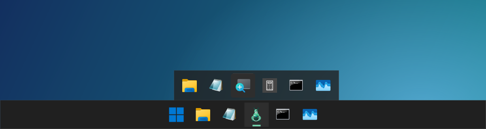
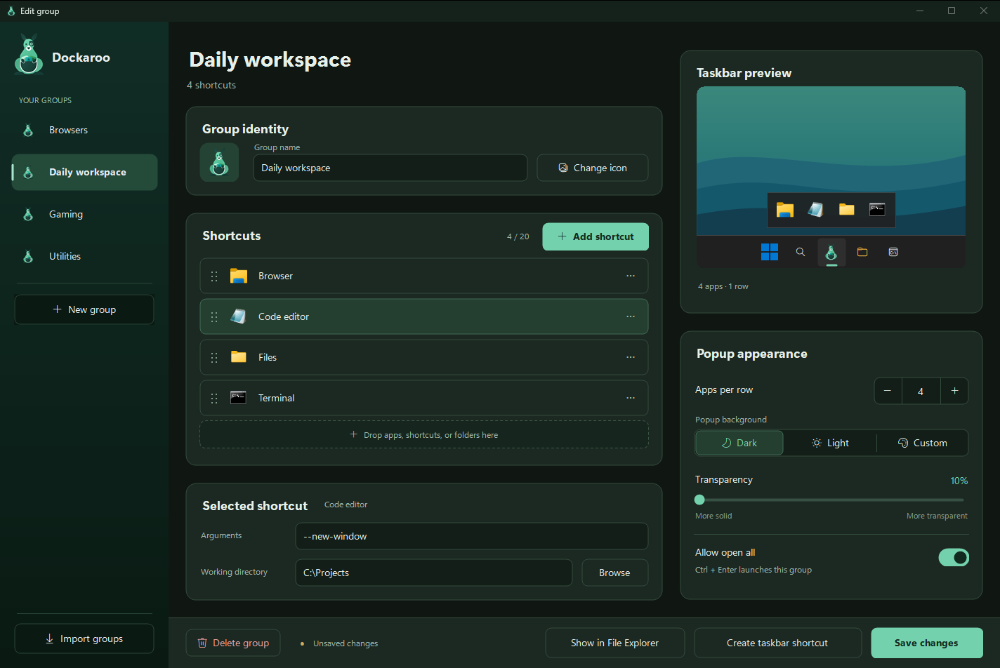
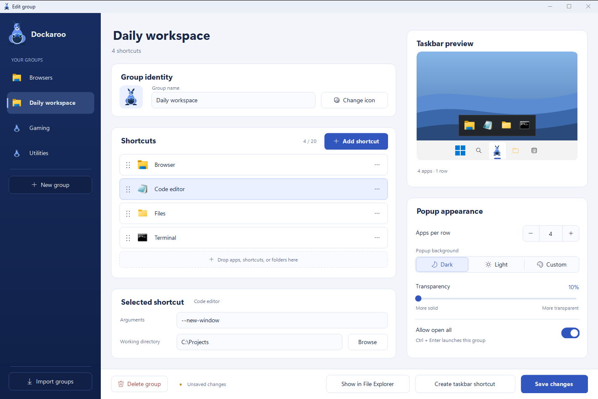
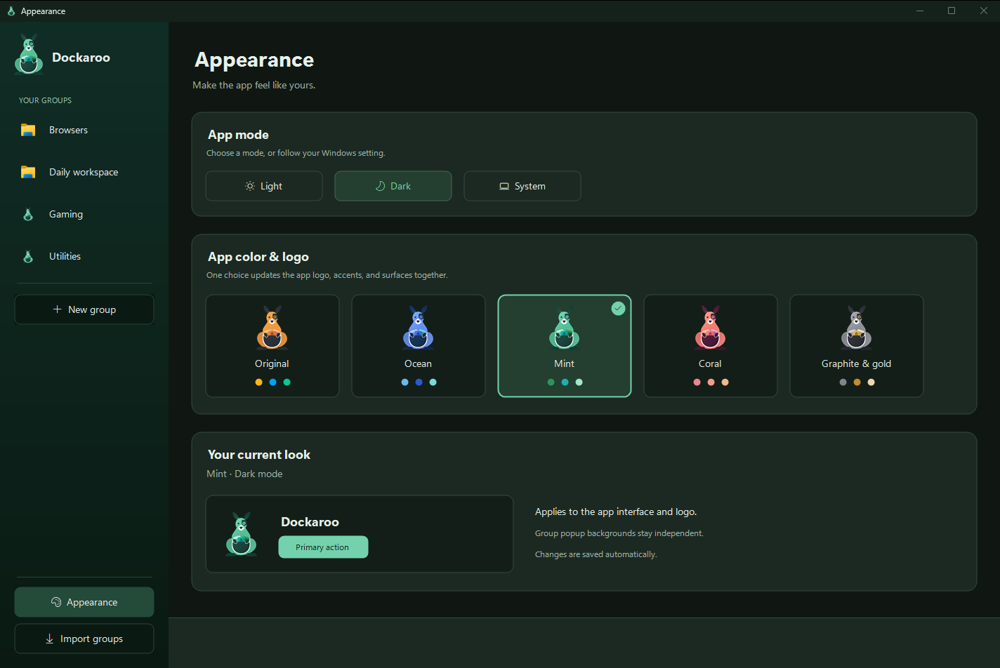
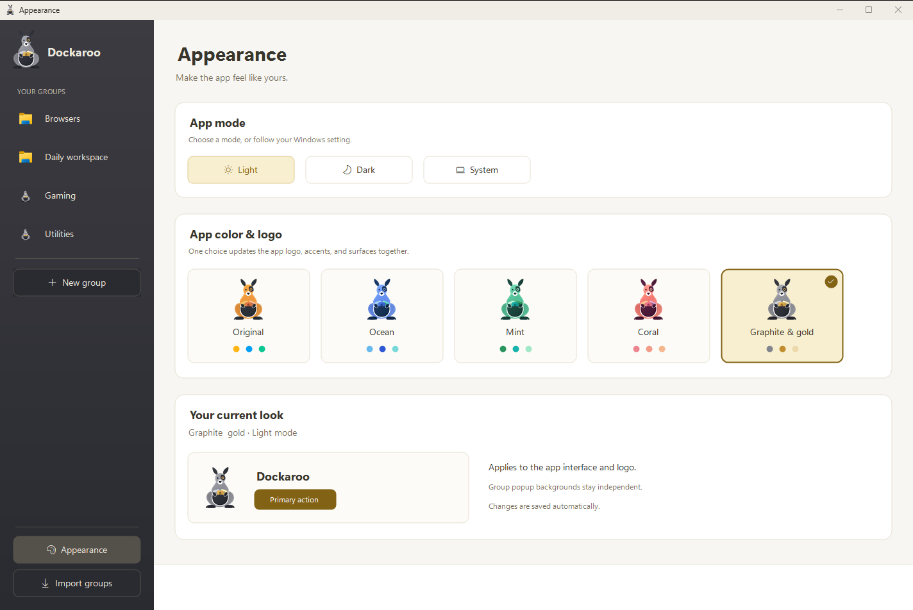
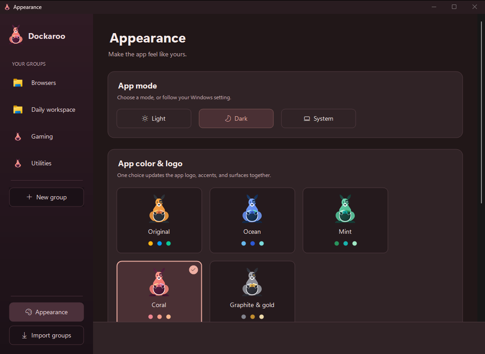
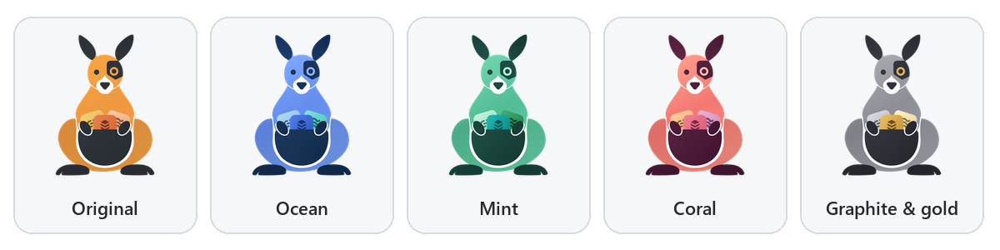
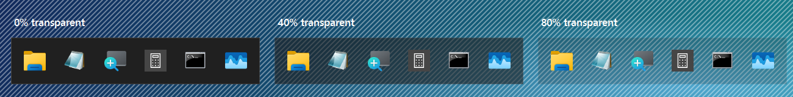

<p align="center">
  
</p>

<h1 align="center">Dockaroo</h1>

<p align="center">
  Taskbar groups for Windows 11. One pinned button per group, one click to see its apps.
</p>

<p align="center">
  
</p>

Windows 11 took away taskbar toolbars, so you either pin every app you use or dig through the
Start menu. Dockaroo puts a group of apps behind a single taskbar button. Click the button and a
small popup opens right on top of it, drawn to look like part of the taskbar. Click an app and
it launches. Click anywhere else and the popup is gone.

Dockaroo is a work in progress. It already runs my own taskbar. The screenshots below come
from the app itself (see [How the screenshots were made](#how-the-screenshots-were-made)).

## What it does

- **One button per group.** Each group gets its own `.lnk` with its own AppUserModelID, so
  Windows treats it as a separate taskbar button with its own icon.
- **The popup opens on its button.** Dockaroo finds the clicked button through UI Automation and
  centres the popup on it, tucked under the taskbar's edge so the two share one border line.
- **The popup does no disk IO.** One resident tray process preloads every group and every icon at
  startup. A click starts a tiny second instance that passes the request to the resident over a
  named pipe and exits. The popup paints from memory.
- **The taskbar shows the group as open.** The popup window carries the group's AppUserModelID,
  so Windows merges it under the pinned button and shows the button's selected state.
- **Keyboard.** `1` to `9` and `0` launch the first ten entries. `Ctrl+Enter` opens the whole
  group if you allow it. `Esc` closes the popup.
- **Transparency that leaves icons alone.** The popup is a per-pixel-alpha layered window, so the
  transparency slider fades the background and the icons stay solid.
- **Five palettes, light and dark.** Each palette has its own logo, and the editor's colours
  follow the palette. Dark, light or follow Windows.
- **Imports the old app's groups.** Dockaroo started as a rewrite of an older taskbar-groups
  utility, and the editor can import that app's configuration.

## Screenshots

### Group editor

Groups, their shortcuts, popup settings and a live taskbar preview on one page. You can drag
apps, shortcuts or folders onto the list.





### Appearance

One choice sets the app logo, accents and surfaces, and the tray icon follows it.





The editor also has a compact layout for narrow windows.



### The logo

A cyborg kangaroo with the group's apps in its pouch, in all five palettes.



### Popup transparency

The same popup at 0%, 40% and 80% transparency. Only the background fades.



## Progress

Done:

- [x] Group model and XML store, one folder per group
- [x] Icon pipeline: exe, `.lnk`, `.ico`, image files and Microsoft Store apps, cached on disk
      and preloaded into memory
- [x] Resident tray process, single instance, named-pipe hand-off, requests queued during preload
- [x] Popup placed on the clicked button, tucked under the bar, auto-hide taskbar handled
- [x] Per-group `.lnk` with AppUserModelID, so pins and the open popup merge on the taskbar
- [x] Editor: sidebar, shortcut cards with drag reorder, popup settings, taskbar preview,
      unsaved-changes guard, rename and delete
- [x] Pin hand-off. Windows 11 blocks silent pinning, so the editor gives you a chip to drag
      onto the taskbar.
- [x] Appearance: five palettes, light, dark and system mode, themed title bar and scrollbars
- [x] Per-monitor DPI (PerMonitorV2) for the popup and the editor
- [x] Importer for the legacy app's configuration
- [x] Popup transparency on the background only
- [x] Test suite: 298 core tests and 167 app tests (xUnit)

Next:

- [ ] Use the palette logo as the default taskbar icon for groups without a custom icon
- [ ] Startup hardening: build the tray menu before any shell call, and move the pin check off
      the startup path
- [ ] Robustness backlog: pick up hand edits to group files, rename edge cases, importer
      tolerance for odd legacy names ([docs/BACKLOG.md](docs/BACKLOG.md))
- [ ] Editor polish: autoscroll while dragging, UI Automation children for the owner-drawn lists
- [ ] Check the editor on a monitor above 100% scaling (mine are both at 100%)
- [ ] A release build and an installer

The full status, open items and decisions are in [NEXT.md](NEXT.md). [docs/HISTORY.md](docs/HISTORY.md)
records how the project got here.

## Build and run

You need Windows 11 and the .NET 9 SDK.

```
dotnet build Dockaroo.sln -c Release
dotnet test Dockaroo.sln -c Release
dotnet run --project src/Dockaroo.App -c Release
```

The app starts in the notification area and opens the editor. Create a group, add apps, then
press **Create taskbar shortcut** and drag the chip onto the taskbar. Clicking that button opens
the group's popup.

To install a copy outside the repo:

```
dotnet publish src/Dockaroo.App -c Release -o <install folder> --self-contained false
```

Groups, cached icons and settings live in `%LOCALAPPDATA%\Dockaroo`. Pins point at the exe, so
moving the install folder later means re-pinning. [BUILD.md](BUILD.md) has the details,
including `Dockaroo.exe --create-link "<group>"` for writing a group's shortcut from the command
line.

## Project layout

```
src/Dockaroo.Core    model, group store, icons, .lnk writer, popup geometry, themes, legacy import
src/Dockaroo.App     tray process, popup, taskbar hit-testing, editor (WinForms, .NET 9)
tests/               xUnit tests for both projects
tools/               off-screen capture tools used for visual checks
```

## How the screenshots were made

The editor screenshots come from `tools/EditorCapture`, which opens the real editor off-screen
with sample data and captures it with `PrintWindow`. The popup images are the popup's own
rendered frames (the exact bitmap the window shows) placed over a drawn backdrop and taskbar.
None of them are mockups of features that don't exist. The project's test rules forbid
capturing the real desktop, so there is no live taskbar screenshot yet.

## Credits and license

MIT, see [LICENSE](LICENSE). Dockaroo is a rewrite inspired by an earlier MIT-licensed taskbar
grouping utility by Jack Schierbeck.
